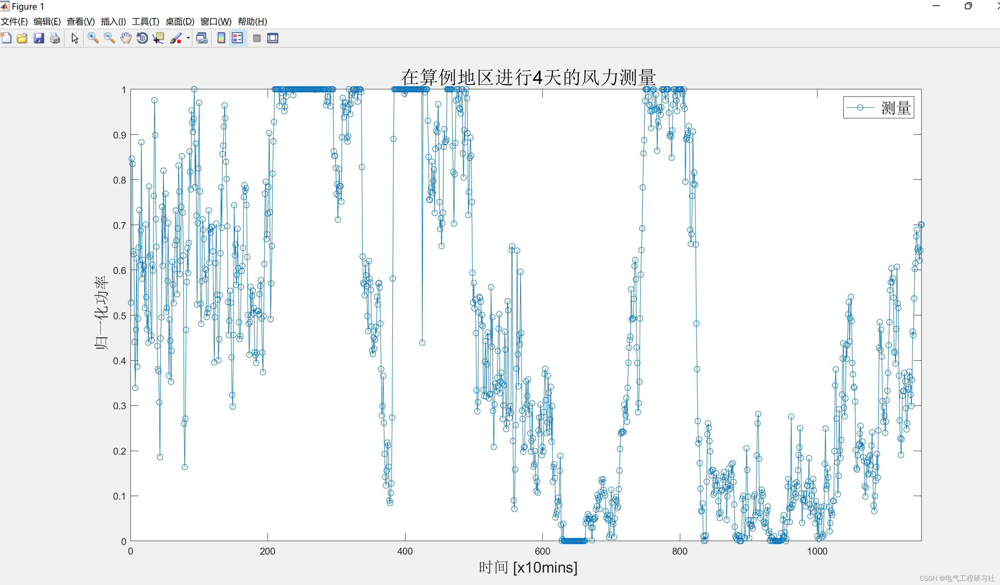
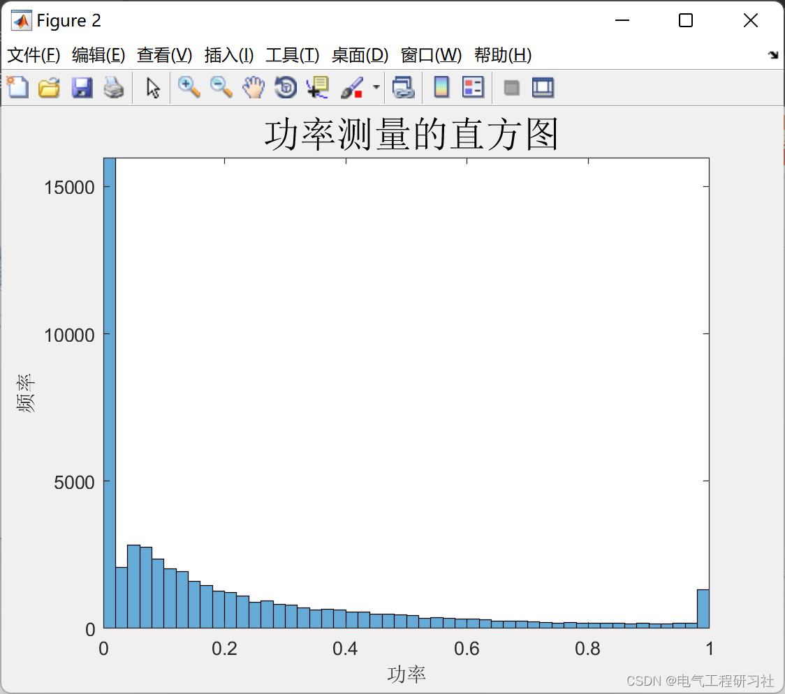
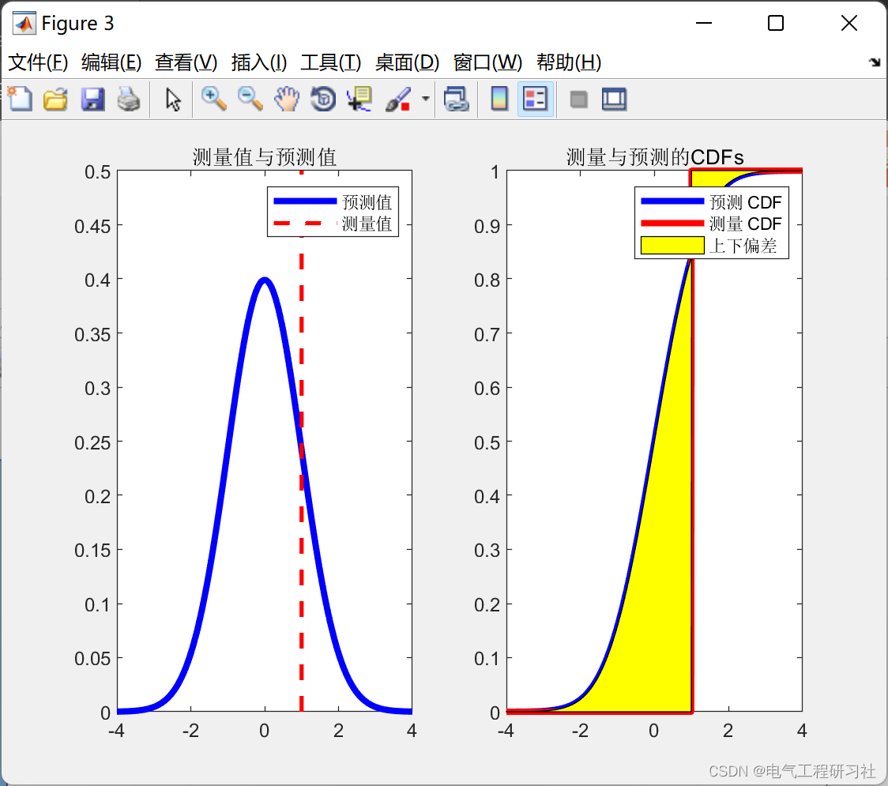
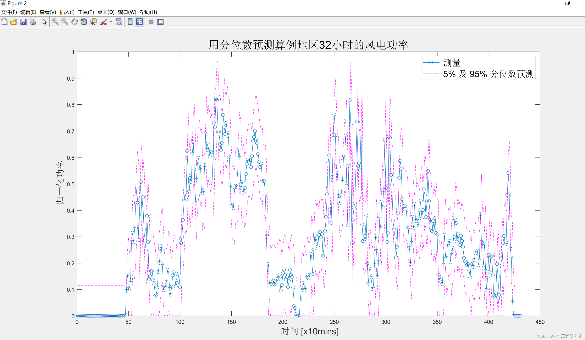
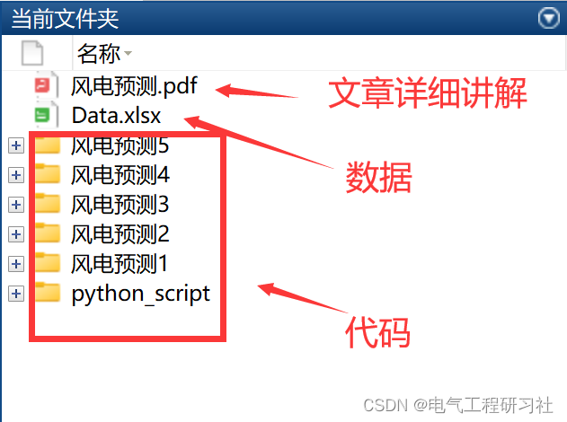
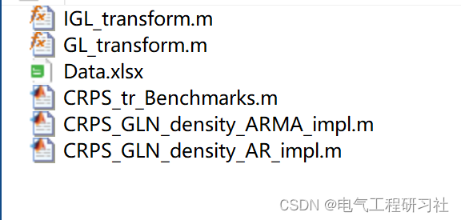

# Short-term wind power generation probability prediction based on Matlab code implementation

Editor
This article is organized as follows: ⛳️⛳️⛳️Table of Contents: 1. Overview 2. Definition and Background 3. Prediction Methods 4. Dynamic Models 5. Evaluation Methods 6. Running Results 7. MATLAB Code 8. Conclusion and Discussion 9. Final Thoughts In fact, for a long time now, we have recognized that our energy production system is not stable. In the face of exponential population growth and lesser degree of climate change, this situation will not be stable in the long term. Therefore, we must change our energy production model to have a fixed system. We must remember that our energy production system is an inevitable global challenge at present. The energy sector is very complex for several reasons. One of its complexities is the highly technical process, and each industry has its own specific characteristics. Energy is a key point in the development of economics in various countries. When a country's power goes out, it results in many economic losses. We can measure these losses by multiplying the county's GDP by the time of collapse. Therefore, an efficient power grid is crucial for maintaining economic growth.
Nowadays, short-term wind power forecasting is a crucial challenge. Particularly for wind power generation, which has large fluctuations and is difficult to predict. This paper builds on the framework of probabilistic forecasting and should consider the nonlinearity and bimodal nature of this stochastic process. The generalized log-normal distribution and the discrete and continuous mixture of boundary probability mass are used to provide probabilistic forecasting. Pinson (2012) indicates that this method outperforms the classical model for wind power production, which assumes that the shape of the prediction density follows normal and Beta distributions. To estimate the position and scale parameters, a simple autoregressive and autoregressive moving average model was designed. The first aim of this paper is to extend the model of Pinson (2012) by introducing the dynamic structure of wind power generation positions. The second aim is to analyze the predictive ability of the proposed model.
This article includes the following content: 1. Overview 2. Definitions and background 3. Forecasting methods 4. Dynamic models 5. Evaluation methods 6. Running results 7. MATLAB code 8. Conclusions and discussions. In this chapter, key assumptions for wind power distribution and data conversion are introduced. Since the Laplace era, normal distribution has played a significant role in both theoretical and applied statistics. Nevertheless, it is evident that the normal distribution cannot accurately represent all distributions in statistical domains. In the late 19th century, many mathematicians attempted to construct frequency curve systems in order to provide a wider distribution than the normal curve. Therefore, on the basis of many works done in the past, we can have a better distribution to simulate wind power than normal distribution. A good model should consider some well-known characteristics of wind data. As mentioned in the introduction, one fundamental characteristic of wind power variable is its bi-boundedness, meaning that the variable can take values between zero (zero production) and its nominal capacity (maximum production). We can use ! Represents the nominal capacity. It can depend on the framework, in a sense, if the research is applied to special wind turbines or general wind farms, or also to wind energy combined energy. Furthermore, as Pinson (2012) states, the characteristic of wind energy variability is a nonlinear function of wind speed. Furthermore, wind energy measurement and prediction are based on the nominal capacity (! Standardization. Therefore, the variable can take values in the range [0,1]. Therefore, in the remainder of this work, wind power measurement will be considered standardized. These various features of wind power modeling indicate that the prediction density cannot be Gaussian. Furthermore, this key result is correct for any time resolution of the wind power time series and any considered prediction range. Particularly, Pinson (2012) demonstrated that the generalized logit normal distribution outperforms the classical distribution for wind power modeling, which consists of a normal distribution and a Beta distribution. Mathematical descriptions are provided in Section 6.
3 Prediction methods Many authors, such as Lange (2005) and Pinson (2006), have demonstrated that the standard deviation of the prediction error distribution is directly related to its conditional expectation. This peculiarity is unrelated to time periods, scopes, and predictive models. Therefore, this characteristic should not be overlooked in predictions related to wind power generation. In particular, Pinson (2012) addressed this issue by using appropriate GL transformations for wind energy time series, assuming that the variance of the transformed prediction density is independent of its mean to mitigate the impact. Considering these characteristics, we hypothesize that the prediction density for wind power generation is at:
For detailed explanations, refer to Part VI.
4 Dynamic Models 5 Evaluation Methods 6 Operational Results 6.1 Case Study Results
Editor
Editor
Editor
6.2 Example 2
Editor
7. The Matlab code in this article only displays a part of the code, the full code can be found here:
Editor
Editor
Editor
Editor
8 Conclusion and discussion
​  

## Images

<!-- PAYMENT_BLOCK -->

## Get this dataset

- Payment link (Stripe): [Buy now](https://buy.stripe.com/3cs8yP7sY87d0vu9AB)
- Payment QR code: 

<!-- /PAYMENT_BLOCK -->
